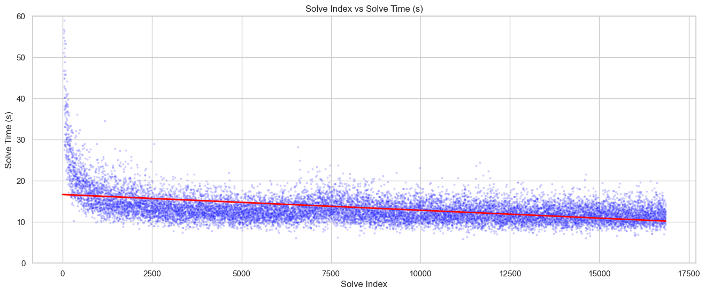

# Virtual Rubik’s Cube Performance Analysis

**Ben Saperstein · Northwestern University · STAT 303-1 & STAT 303-2**

What can five years of my virtual Rubik’s Cube solves reveal about performance? These two course projects examine my own keyboard-controlled solves on [csTimer](https://cstimer.net), from exploratory analysis to regression and regularization.

## Start here

- **[Project overview](docs/project-overview.md)** — questions, methods, findings and limitations.
- **[Fall 2025 report — exploratory analysis](fall-2025-stat303-1/fall-2025-report.ipynb)** — STAT 303-1, Fall 2025; saved charts and interpretation.
- **[Winter 2026 report — regression analysis](winter-2026-stat303-2/winter-2026-report.ipynb)** — STAT 303-2, Winter 2026; eight linear specifications and a polynomial Ridge model.
- **[Validation notes](docs/methods-and-limitations.md)** — how to interpret the original results and what a stronger evaluation requires.

## At a glance

| Stage | Dataset | Approach |
| --- | --- | --- |
| Exploratory analysis | 16,856 solves before cleaning; 16,776 after removing 80 observations; 14 variables | Correlations, learning trends, weekday and time-of-day comparisons |
| Regression analysis | 22,442 solves; 15 variables; 17,953 training / 4,489 test observations | Eight expanded linear models, then degree-2 polynomial Ridge regression with five-fold cross-validation |

Both stages use overlapping snapshots of the same personal session, beginning in December 2020. Their counts should **not** be added together. These are virtual solves, distinct from my physical WCA competition results.

## Findings and interpretation

- The exploratory report associates longer pauses with slower solves and shows rapid early improvement followed by a slower, uneven learning curve.
- The regression project compares nine specifications and examines how movement, pauses and temporal features relate to solve time.
- These are observational relationships from one solver. They do not establish that a practice intervention causes improvement or generalize automatically to other cubers.

**Model interpretation matters:** original models 2–9 use `turn_speed_tps = number_of_turns / solve_time_s`. Because that feature contains the target, their test scores are not valid evidence of predicting an unknown solve time. Several other features are available only after a solve. Original course outputs are retained; the [validation notes](docs/methods-and-limitations.md) explain the issue. A corrected evaluation has not yet been run.

*Original STAT 303-1 plot; this earlier dataset is smaller than the regression snapshot.*

## My contribution

I chose the research questions around my own solving history, interpreted results, and developed the course analyses and reports. With instructor permission, I used AI assistance to parse the nested csTimer export and compute movement metrics. The original reports disclose that assistance. Later portfolio documentation clarifies scope and limitations; it does not represent a new completed model experiment.

## Files and reproduction

| Term and course | Report | Code | HTML exports |
| --- | --- | --- | --- |
| **Fall 2025 · STAT 303-1** | [Fall report](fall-2025-stat303-1/fall-2025-report.ipynb) | [Fall code](fall-2025-stat303-1/fall-2025-code.ipynb) | [Report](fall-2025-stat303-1/fall-2025-report.html) · [Code](fall-2025-stat303-1/fall-2025-code.html) |
| **Winter 2026 · STAT 303-2** | [Winter report](winter-2026-stat303-2/winter-2026-report.ipynb) | [Winter code](winter-2026-stat303-2/winter-2026-code.ipynb) | Not included |

The **report** presents the questions, findings and interpretation; the **code** notebook contains the implementation. Each term has its own folder and date-labeled filenames. Setup and execution details are in [reproduction instructions](docs/reproducing.md).

GitHub displays notebooks and their saved outputs without executing them. To view existing HTML reports as rendered pages, download and open them locally.

Use Python 3.12 or newer and [requirements.txt](requirements.txt). The original `cstimer_data.txt` export is **not included**. This repository currently supports inspection of saved analysis, not complete fresh reproduction; see the reproduction instructions before running it.
